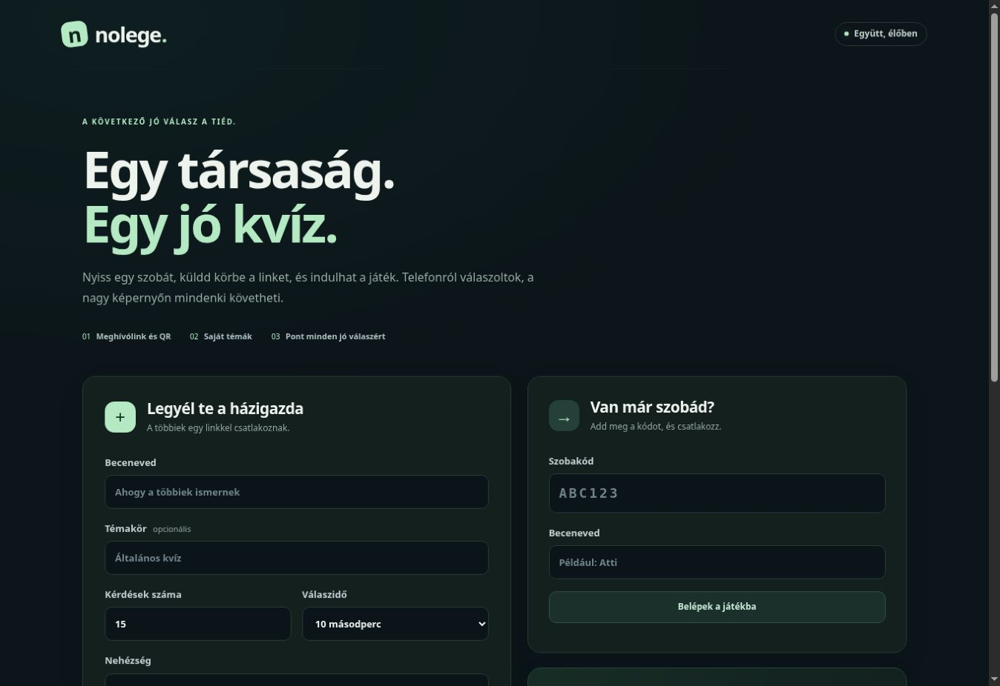

# Nolege 2.0 – ellenőrzési jegyzőkönyv

Ellenőrzés: 2026. október 27. Az éles alkalmazás címe: https://nolege-party-attila314dev.onrender.com/.

Az éles, ellenőrzött alkalmazáskód: `5c7fc519f22062d0e9b99fd7aa3649cf6c666953`.
A jegyzőkönyvet tartalmazó következő commit csak tesztet és dokumentációt módosít.

## Automatizált ellenőrzések

- `npm test`: **32 sikeres teszt, 0 hiba**, a beágyazott tesztesetekkel együtt.
- `npm audit --omit=dev --audit-level=high`: **0 sérülékenység**.
- A JavaScript-fájlok szintaktikai ellenőrzése és a `git diff --check` sikeres.
- Valódi helyi HTTP- és WebSocket-kapcsolatokkal ellenőrizve: meghívó és jelszó, házigazdajogok, kész jelzés, minden helyes válasz pontozása, ismételt válaszok kizárása, frissítés és visszacsatlakozás, nézői szinkron, új forduló, szobabezárás, kérdésszám, témaszűrés és csomagimport.
- Külön teszt ellenőrzi, hogy két böngészőlap játékosazonossága frissítés után is külön marad.
- Az AI kérés- és válaszfolyama tesztszolgáltatóval ellenőrizve: strukturált kérdéscsomag, előzetes jóváhagyás, beszélgetés, hibás adatok, hiányzó kulcs, hitelesítési hiba, kvóta és időtúllépés. A tesztadatok nem kerülnek az éles működésbe.

## Éles, kétjátékos próba

2026-10-27 17:41–17:42 UTC között három kérdéses játék futott le két külön játékos HTTP- és WebSocket-kapcsolatával.

| Ellenőrzés | Eredmény |
| --- | --- |
| Alkalmazás és bank | 2.0.0, 140 érvényes kérdés |
| QR-kód | Független QR-olvasóval visszafejtve; pontosan a meghívólinkre mutat |
| Kérdéscsomag | Letöltés és visszatöltés az éles API-n sikeres |
| Három kérdés | Mindkét játékos mindhárom helyes válaszára kapott pontot |
| Végső eredmény | 594 és 588 pont; a különbséget a gyorsasági bónusz adta |
| Kérdéssegéd | Kulcs nélkül a bankból válaszolt, ezt egyértelműen jelölte |
| Tesztszoba | A próba után eltávolítva |

## Böngészőben ellenőrzött felület

Sikeres: kezdőlap, szobalétrehozás, QR megjelenítés, meghívó másolása, csatlakozás becenévvel, kész jelzés, házigazda frissítése külön vendéglap mellett, kérdéscsomag előnézete és szerkesztése, mentés, letöltés.

A fájlválasztón keresztüli visszatöltési próba a böngésző automatizálásában elakadt, ezért erre nincs sikeres böngészős ellenőrzés. A szerver importútvonala az automatizált teszteken és az éles API-próbán is sikeres volt.

## Az AI éles bekapcsolása

Az ellenőrzéskor nem volt beállítva valódi szolgáltatói API-kulcs (`aiConfigured: false`). A valódi Groq-szolgáltatóval végzett generálás és beszélgetés még nincs ellenőrizve.

A Render szolgáltatás **Environment** beállításában add meg a `GROQ_API_KEY` változót, majd válaszd a **Save, rebuild, and deploy** műveletet. A teljes beállítást és az opcionális második szolgáltatót a [readme.md](readme.md) írja le.

Kulcs nélkül a 140 kérdéses bank, a kézi szerkesztés, a csomagok mentése és visszatöltése, valamint a bankból dolgozó kérdéssegéd használható. A felület megkülönbözteti a bankból és az AI-tól érkező tartalmat.
